# Project 2: SOC Automation Lab (SOAR)

**Wazuh · n8n · TheHive · Sysmon · AbuseIPDB · Slack · Docker · VMware**

I built a SOC where n8n manages the alerts from Wazuh, which flow into TheHive for case management and are sent to a Slack channel where the analyst will see them. n8n is responsible for the automated triage. The blocking of the attacker is done by Wazuh Active Response. Wazuh is the SIEM, n8n is the engine of the SOAR that takes care of the orchestration and automation, and TheHive is the case management system that supports the response. Together they make a SOC stack with SOAR capabilities.

Problem: A SOC that can only detect attacks without responding automatically is vulnerable, because attacks can succeed while there is no active defense. I created a SOC that responds automatically, so attacks are blocked, enriched and reported within seconds instead of waiting in a dashboard for someone to notice. This closes the gap between detecting an attack and responding to one.

- Triage decides which alerts matter.
- Enrichment researches the attacker.
- Slack makes sure someone notices.
- TheHive creates the ticket.
- Active Response blocks the attacker.
- Health monitoring makes sure the system never fails silently.

As a result, I created a pipeline that works automatically. I tested an SSH brute-force attack, which was detected, blocked, enriched, reported and ticketed within a second without any human involvement.

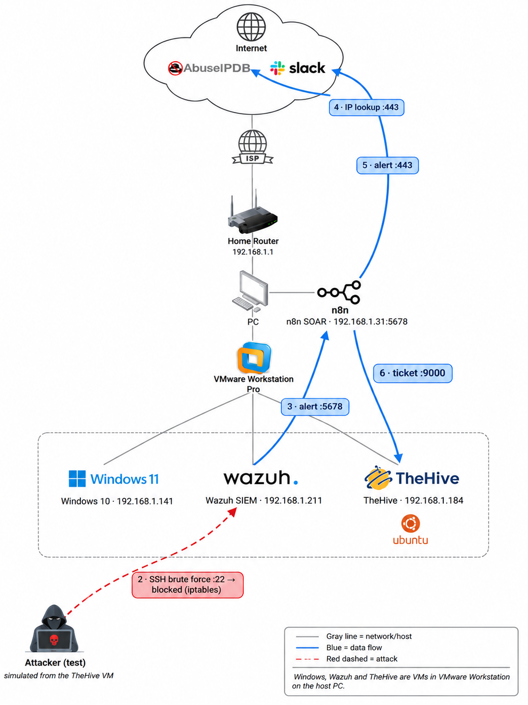

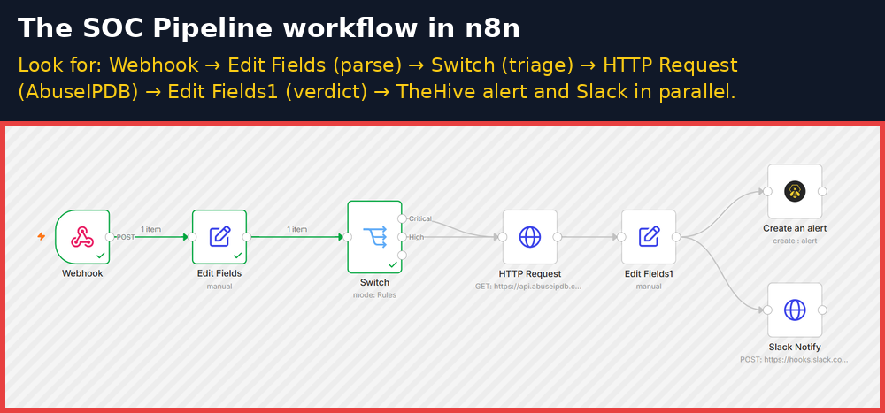

## Results at a glance

| Measure | Result |
|---|---|
| Detection → Slack alert + TheHive ticket | **under 1 second** |
| Automatic block | after **8** failed SSH attempts, for **180 seconds**, then auto-unblock |
| Alerts filtered at triage | **10 of 13** |
| Time to acknowledge (MTTA) | **14 min 14 s** |
| Time to resolve (MTTR) | **4 min 18 s** |
| Tests passed | **16 of 16** (Linux SSH brute force + Windows/Sysmon) |

## Contents
- [Environment](#environment)
- Phases 1–12: [Windows + Sysmon](#phase-1-windows-vm-sysmon-and-the-wazuh-agent) · [n8n + integration](#phase-2-n8n-and-the-wazuh-integration) · [Parsing](#phase-3-parsing) · [Triage](#phase-4-triage) · [Enrichment](#phase-5-enrichment) · [Slack](#phase-6-slack-alerts) · [TheHive build](#phase-7-thehive-server-build) · [n8n → TheHive](#phase-8-n8n-to-thehive) · [Analyst workflow](#phase-9-analyst-workflow) · [Automatic response](#phase-10-automatic-response) · [Health monitoring](#phase-11-health-monitoring) · [Final testing](#phase-12-final-testing)
- [Limitations and improvements](#limitations)
- [Repository contents](#repository-contents)
- [Keywords](#keywords)

## Environment

- Physical host: my computer
- VMware Workstation allows me to create isolated virtual computers on my PC
- VM 1: Windows 10 (SOAR-Windows10) with Sysmon and the Wazuh agent (an employee's laptop)
- VM 2: Wazuh server (192.168.1.211), the central security server that runs the Wazuh engine, database and dashboard
- VM 3: TheHive server on Ubuntu (192.168.1.184), where incidents turn into tickets
- n8n on my host PC (192.168.1.31), plus Slack and AbuseIPDB in the cloud

Permission: I own every system, and all attacks were run by me against my own virtual machines.

## Phase 1: Windows VM, Sysmon and the Wazuh Agent

The first phase of this project was powering on the employee's computer, a Windows virtual machine in VMware. This is what I will protect and monitor.

I then downloaded Sysmon, which is responsible for monitoring my Windows VM. I used a dedicated folder and extracted Sysmon64.exe into it, so that the program file has a stable location, since it runs as a service every time Windows boots. If it ran from a Downloads folder or another temporary location, it would cause errors at boot. After downloading it, I opened PowerShell as an administrator on the Windows VM and installed Sysmon from that folder. I had to run it as an administrator because Sysmon is a background service that requires privileged rights. It now writes detailed system events into the Windows Event Log.

By default, Sysmon has no rules, doesn't always log what is needed, and often misses critical attack behavior. I downloaded and applied SwiftOnSecurity's Sysmon XML configuration. This is a prebuilt set of rules that tells Sysmon what system activity to monitor and log for security investigations. It focuses on things such as process creation, network connections, and file creation and changes.

The next step was installing the Wazuh agent on my Windows VM. An agent is a small program you run on a computer so a central server can watch it. Sysmon writes down everything that happens on the Windows VM, but those notes are kept on that machine only. Wazuh is on a different machine, so it can't see those notes on its own. That's where the Wazuh agent comes in: it is the bridge that sits on the Windows VM, reads Sysmon's notes, and sends them across the network to Wazuh.

Wazuh acts as the brain. It takes Sysmon's recordings and checks whether anything is an attack. It comes with thousands of pre-written rules. When an event from Sysmon matches a Wazuh rule, it raises an alert with a severity level from 0 to 15. Wazuh is also responsible for blocking the attacker with its firewall rule.

## Phase 2: n8n and the Wazuh Integration

I then had to figure out how to make something actually happen when Wazuh raises an alert. I decided to go with n8n, an automation tool for building workflows by connecting nodes together, where each node has a different task. The first step was to install Node.js, because n8n cannot run without it. Node.js is basically the engine, while n8n is the car. n8n allowed me to sort alerts, look up IPs and open tickets. It runs on my host PC at localhost.

Once in n8n, I created a workflow that started with a Webhook node. A webhook is a web address that waits for data to arrive. Mine was waiting for Wazuh alerts. I set the method to POST, which tells n8n to expect data to be sent to it, not someone asking for a web page.

I then directed Wazuh to send alerts to the webhook in a config file called ossec.conf. I added an integration block that says, "When an alert pops up, run a script and send the alert to this address," with the address in hook_url. ossec.conf is basically Wazuh's instruction manual, and I added another page to it. The script is a small Python program that packages the alert as JSON and sends it to n8n.

To see if alerts actually reached n8n, I had to test the workflow. First, I gave the script the right permissions on the Wazuh VM:

```
chmod 750 /var/ossec/integrations/custom-n8n*
chown root:wazuh /var/ossec/integrations/custom-n8n*
```

This means root can edit it, the wazuh group can run it, and nobody else can touch it.

I then restarted Wazuh, because it only loads ossec.conf and the integration at startup.

The next step was getting n8n ready to catch the alert. I opened the Webhook node and clicked Listen for test event, which waits for the first alert to arrive from Wazuh.

I then created a fake attack to trigger an alert, a failed SSH login to the Wazuh VM using a fake username, to see if the pipeline worked.

The alert didn't arrive, so I looked at Wazuh's logs and found and fixed the following issues:

| Order | Error I saw | Cause | Fix |
|---|---|---|---|
| 1 | "unexpected EOF" from integratord | Broken script files | Replaced them with a clean script |
| 2 | Duplicate blocks, no &lt;hook_url&gt; | A messy config restored from the backup | Kept one clean integration block |
| 3 | Errno 113 to 192.168.1.100 | An old IP that doesn't exist | Set &lt;hook_url&gt; to my PC's real IP |
| 4 | Timeout after 10 seconds | Windows Firewall on my host PC blocking port 5678 | Added a firewall rule allowing port 5678 |

The alert then arrived in the n8n Webhook node with its data shown. HTTP 200 appeared, which means n8n confirmed it received the alert. I then published the workflow so the webhook listens permanently, not just during the test.

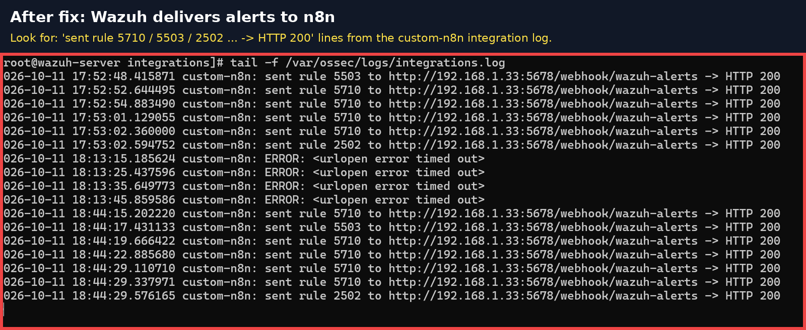

## Phase 3: Parsing

The next phase was parsing.

The alerts from Wazuh come as huge blocks of data, and most of it is not useful to an analyst. I added an Edit Fields node in n8n, right after the Webhook node, to pull out only the important information an analyst would need to see:

- what happened
- how serious it is
- which machine
- the attacker's IP
- the user
- the MITRE technique
- the timestamp
- the raw log

This is normalization. Every later step reads from this set of fields instead of the raw alert.

## Phase 4: Triage

The next phase is triage. A Switch node reads how serious the alert is, which comes from the Wazuh rule level (0–15) that the parsing step pulled out, and sorts the alert into Low, High or Critical: Critical is level 12 and above, High is level 7–11, and Low is below 7. Low alerts stop there, but Critical and High alerts continue to the AbuseIPDB lookup. AbuseIPDB is a website that looks up an IP address to see its history, such as whether it has been reported as malicious. This way, analysts focus on the dangerous alerts first, and the workflow doesn't use up AbuseIPDB's lookup limit.

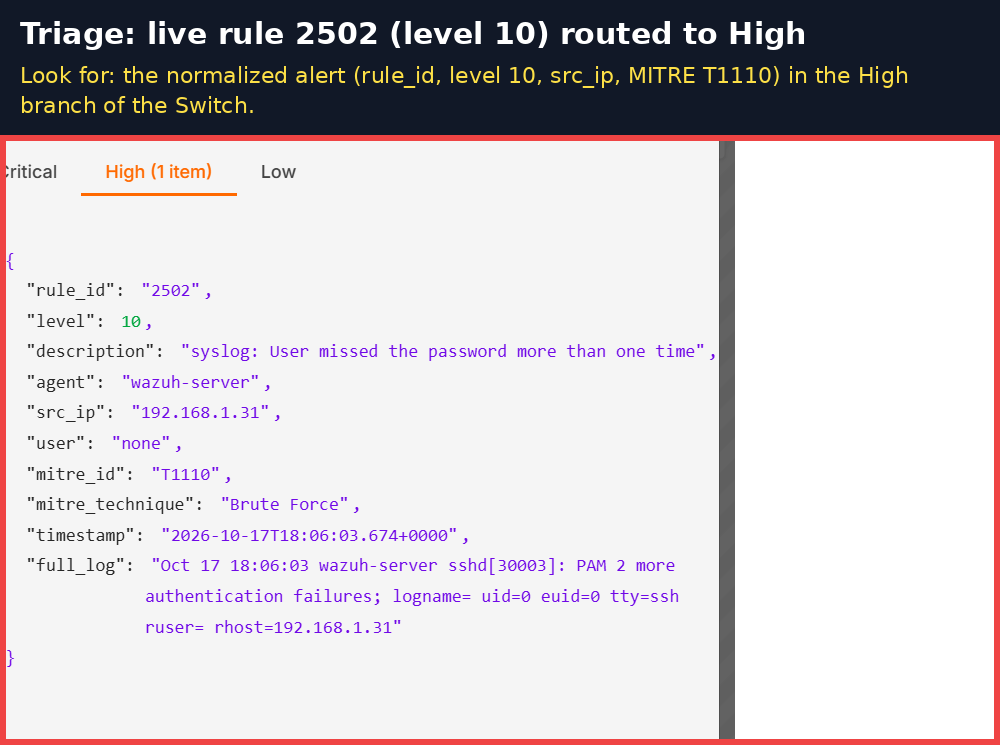

## Phase 5: Enrichment

AbuseIPDB is a database that tracks and shares IP addresses linked to malicious activity. My next step was adding an HTTP Request node in my SOC Pipeline workflow in n8n. It connects to the High and Critical outputs of the Switch node; one node can take input from multiple branches. I used the GET method, which means "give me information." The URL is AbuseIPDB's API, and the IP is taken from the alert sent by Wazuh.

AbuseIPDB needs to know who's asking, so I stored an API key in the HTTP Request node, where I set Authentication to Header Auth. I created a credential with the Name "Key" and my API key as the Value, then set Allowed Domains to api.abuseipdb.com. You can think of this API key as a locked ID badge that only works for one building. AbuseIPDB replies with data about the IP, and the most important fields are:

| Field | Meaning | Example |
|---|---|---|
| abuseConfidenceScore | How likely the IP is malicious, from 0 to 100 | 100 |
| totalReports | How many times it's been reported | 512 |
| isPublic | Is it a real internet IP, or a private one like 192.168.x.x? | true |
| countryCode | Where it's located | CN |
| isp | Who owns the IP | Some hosting company |

A verdict is then added by a second Edit Fields node, called Edit Fields1. It reads the AbuseIPDB data and labels the alert automatically:

| Order | Check | Verdict | Plain English |
|---|---|---|---|
| 1 | No IP at all (a Windows host alert) | no-ip (host alert) | Nothing to look up |
| 2 | IP is not public (192.168.x.x) | internal | It came from inside our own network |
| 3 | Score is 50 or higher | malicious | Known attacker |
| 4 | Score is above 0 | suspicious | Some reports, worth watching |
| 5 | Score is 0 | clean | No history |

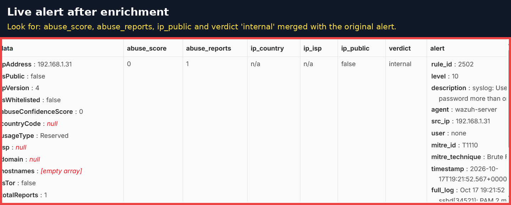

In my lab there were two attacks: an SSH brute force and a certutil download, which is when something happens on the Windows machine itself. The certutil download has no IP address, unlike the SSH brute force, which does. For the Windows alert, the IP just says "none."

I ran into an issue because when the Windows alert reached AbuseIPDB, there was no IP address to look up, which caused an error. By default, n8n then stops the whole workflow, so the alert would never reach Slack or TheHive.

I only got a WORKFLOW FAILED message from the Error Handler in n8n. In my SOC Pipeline, I clicked on the HTTP Request node, opened Settings, and set On Error to Continue. This way, if the lookup fails, the workflow continues instead of stopping. If the answer is empty, such as when there is no IP address, it writes "n/a." The abuse_score field was set to Number and only accepted digits, so when it got "n/a," which isn't a number, another crash occurred. The fix was changing the field's type to String (text), which accepts both digits and letters. The alert is now labeled "no-ip (host alert)," which means it occurred on the machine itself, so there isn't an IP to look up.

## Phase 6: Slack Alerts

Without Slack, an analyst would need to open n8n or Wazuh to actually notice an alert. Slack is an app many security teams use. I set up a node for Slack so that the team in the Slack channel is notified within seconds on their own computer or phone.

I went to Slack in my browser, created an account, and made a workspace and a channel for alerts. The dedicated channel is so alerts aren't buried in normal conversation.

I then used another webhook, this time a URL from Slack; anything sent to it appears as a message in the channel.

Back in n8n, I opened the SOC Pipeline workflow and created an HTTP Request node that sends a POST to the Slack webhook URL. It connects after Edit Fields1, the verdict step, so the message includes everything gathered. The message is automatically filled from the parsed fields and the enrichment with:

- Severity (Critical / High), from triage
- What happened: rule ID and description
- Which machine: the agent name
- Attacker IP and user
- MITRE technique: e.g. T1110 Brute Force
- Verdict and AbuseIPDB score, from enrichment
- Timestamp

This allows the analyst to see and understand the alert without logging into anything.

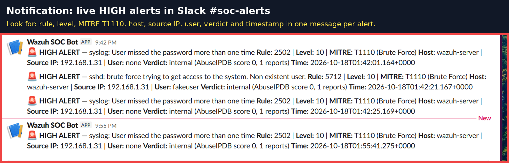

The next step was to get Slack and TheHive running at the same time. Edit Fields1 connects to both Slack and TheHive, and they run in parallel because it's faster, and if one fails, the other still gets the alert. To test this, I ran a brute-force attack, and the message appeared in my Slack channel in under 1 second. The Windows alert later showed up as Critical.

## Phase 7: TheHive Server Build

When Slack gets an alert and shows it in the channel, the alert scrolls away, and you can't assign it, track progress or keep a record of what you found. A SOC needs a case management system where each alert turns into a ticket that an analyst can assign to someone, investigate, track and close. That's where TheHive comes in; it's a free, open-source tool built specifically for security teams.

The goal was to build a server that runs TheHive. I created a new VM in VMware Workstation, selected Typical, then selected the Ubuntu Server ISO. I used a bridged network so it can work with the other VMs. An ISO is a file containing an operating system installer, like an install disc in file form. This created an empty virtual computer with no software. I then installed Ubuntu Server (an OS like macOS and Windows) and SSH in the TheHive VM's console window. Ubuntu Server has no icons, mouse or Start menu, just a screen to type commands. It's very light and fast, so more of the VM's memory and CPU can go to TheHive. I installed OpenSSH Server to turn on SSH, so I can control the server from my own PC outside of the virtual machine. Now the VM has an OS to run programs. I chose Ubuntu because TheHive is built for Linux, it's lightweight, and it's what most security servers run. I chose SSH because it lets me control the server from PowerShell on my host PC, which is how real admins manage servers from their desk.

I then got the VM's IP by logging into the TheHive VM, running ip a, and looking for the inet line. It shows the address my home router gave the VM. SSH needs to know where to connect, and n8n needs the IP to send alerts to TheHive.

I then connected with SSH from PowerShell on my PC. This failed at first because SSH was trying to connect to the wrong IP address, so I troubleshot:

| Check | Command | Result | Meaning |
|---|---|---|---|
| Is SSH running? | systemctl status ssh | running | The service is fine |
| Is a firewall blocking it? | ufw status | inactive | The firewall is fine |
| Can my PC reach it? | ping from PowerShell | host unreachable | A network/address problem |
| What's the real IP? | ip a | different from what I typed | I had been using the wrong IP |

When I initially created the Ubuntu VM, I allocated 40 GB of virtual disk space. After installation, Ubuntu was using approximately 18 GB, leaving the remaining capacity available for future use.

Before installing TheHive, I connected to the VM over SSH from PowerShell on my Windows host and expanded Ubuntu's logical volume with sudo lvextend -l +100%FREE -r /dev/ubuntu-vg/ubuntu-lv. This was possible because I chose LVM during installation. I confirmed with df -h that the usable space grew to about 38 GB, which matters because Elasticsearch stops accepting data when disk space runs low.

My next step was to install Docker, which allows me to run programs in containers. TheHive needs 3 different programs (TheHive, Cassandra and Elasticsearch), and Docker runs each of them in its own box and starts them together. I did this using PowerShell on my host PC, SSH'd into the TheHive VM.

1. The commands:
  - sudo apt update && sudo apt upgrade -y: refreshes the software list and installs updates
  - sudo apt install -y docker.io docker-compose-v2: installs Docker and Docker Compose
  - sudo systemctl enable --now docker: starts Docker now and on every boot
2. No account needed. Docker is free, and it downloads public images from Docker Hub without a login.
- I allowed my user to run Docker without sudo on the TheHive VM by connecting with ssh soc@192.168.1.184 and running sudo usermod -aG docker $USER.

usermod changes a user's settings, -aG docker adds the user to the docker group, and $USER is me, the user soc.

After that, I exited and ran ssh soc@192.168.1.184 again, because group changes only take effect after a fresh login. Adding soc to the docker group gives it permission to run Docker directly.

I then tested Docker, while SSH'd into TheHive, with docker run hello-world.

Docker downloads a test image from Docker Hub, runs a container, and the container prints "Hello from Docker!" and then closes, which proves that Docker is installed and running.

Then I started TheHive using docker-compose.yml, which describes the 3 containers (TheHive, Cassandra, Elasticsearch) and how they connect.

I did all of this in the TheHive VM. First, I prepared the system for Elasticsearch:

- What: set a Linux setting called vm.max_map_count to 262144, and saved it in /etc/sysctl.d/99-elasticsearch.conf so it survives reboots.
- Why: Elasticsearch needs to map lots of memory areas at once. Ubuntu's default limit is too low, and Elasticsearch refuses to start without this change.

I deployed TheHive using Docker Compose. First, I raised the Linux vm.max_map_count setting, which Elasticsearch needs to start, then made a .env file with a generated secret so it stays out of the main config. The docker-compose.yml file defines three containers: Cassandra 4.1 as the database, Elasticsearch 7.17 as the search index, and TheHive 5.4, which starts after both and connects to them by name over Docker's private network. Only port 9000 is exposed to my network, data is stored in volumes so it survives restarts, and every container is set to restart automatically. I started the stack with docker compose up -d and confirmed all three containers were running with docker ps.

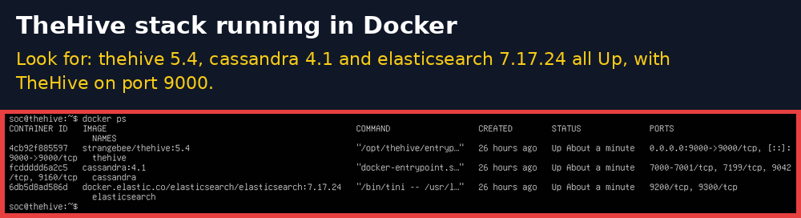

I then logged into TheHive in a browser using http://192.168.1.184:9000

- 192.168.1.184 is the TheHive VM's IP.
- 9000 is the port opened in docker-compose.yml.

I used the default admin account. This proves that the whole stack works: Ubuntu running Docker, Docker running the 3 containers, and TheHive reachable from my network.

## Phase 8: n8n to TheHive

The next phase was connecting n8n to TheHive so tickets open automatically. Without this automation, an analyst would need to read the alert in Slack, log into TheHive, and type everything by hand.

My first step was to make an organization, which I called SOC-Lab, while in TheHive in my browser. In TheHive, the admin org is only for managing the platform; I can't work alerts or cases there, and alerts and cases need to live in a real team organization. The admin org is like building management, while the SOC-Lab org is the security team's office.

I then made a service account for n8n in TheHive: I went to SOC-Lab, then Users, and hit the +. I created a user named n8n@soc.lab, then generated an API key for it. This service account is an account for a program; n8n uses it to log into TheHive automatically. I made a separate account instead of just using the admin account because of least privilege: n8n only needs to make alerts in SOC-Lab. If n8n's API key gets stolen, the damage is limited to what that account can do. It also provides accountability, because TheHive shows "created by n8n@soc.lab," so you know which alerts came from automation and which came from a human.

- I then saved the TheHive credential in n8n: in n8n in my browser, I went to Credentials, then created a TheHive 5 credential. I entered the URL: http://192.168.1.184:9000
- API key

I then added the TheHive node to the SOC Pipeline workflow. The node was TheHive 5 with Resource: Alert and Operation: Create, connected after Edit Fields1. It runs in parallel with Slack.

| TheHive field | Filled with | Why |
|---|---|---|
| Title | Rule description, e.g. "sshd: brute force trying to get access" | Tells the analyst what happened at a glance |
| Description | Rule ID, level, machine, IP, user, MITRE, verdict, AbuseIPDB score, raw log | Everything needed to start investigating |
| Severity | Converted from the Wazuh level to TheHive's 1–4 scale (Low / Medium / High / Critical) | TheHive uses its own scale |
| Source | Wazuh | Where the alert came from |
| Source Ref | A unique ID for that specific alert | Used for deduplication |
| Type | e.g. wazuh-alert | The category of alert |
| Tags | wazuh, the MITRE ID (e.g. T1110), and the verdict | Lets analysts filter and search, e.g. "show all T1110" |
| Observable | The attacker IP | A piece of evidence TheHive tracks. The same IP showing up in other alerts gets linked. |

The tags showed up empty because they were sent as one piece of text, but TheHive expects a list (an array). I changed them to {{ ['wazuh', $json.alert.mitre_id, $json.verdict] }}. The square brackets make it a list.

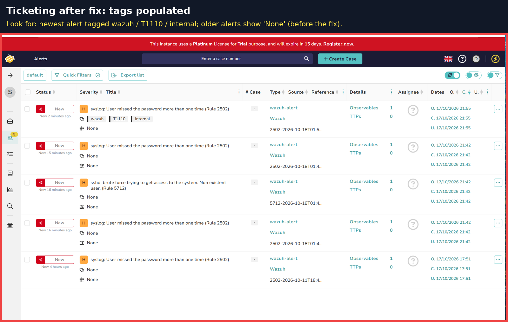

I then got an "already exists" error when I clicked Execute step on the same alert twice. TheHive checks type, source and sourceRef, and if all three match an existing alert, it doesn't make a duplicate. If Wazuh or n8n sends the same alert twice, analysts don't get flooded with copies. I then published the workflow and ran a live attack, which made a new alert with a new sourceRef. I tested it by running the SSH brute force from the TheHive VM against Wazuh, and within 1 second, Slack got the alert and TheHive got a new alert with a title, severity, tags (wazuh, T1110, internal) and the attacker IP as an observable.

```
Wazuh → n8n (parse → triage → AbuseIPDB → verdict) ─┬─> Slack (team notified)
                                                    └─> TheHive (ticket opened)
```

## Phase 9: Analyst Workflow

When I go into the analyst workflow, I start by opening TheHive. I may then see an alert created with all the tags. I then have the following options:

| Option | What it does |
|---|---|
| Assign to me | Takes ownership, so the team knows who's handling it |
| Start | Marks it as being worked on |
| New case | Promotes the alert into a full investigation |
| Merge alert | Adds this alert to a case that already exists (for related alerts) |
| Close | Ends it without a case, e.g. a false positive |
| Ignore updates | Stops new info on this alert from changing it |
| Responders | Runs automated actions on it, which needs extra tools I didn't set up |

I chose to assign it to myself and start it, so I clicked Assign to me and Start. In a team, two analysts shouldn't work on the same alert without knowing it, so assigning it shows who is working on it. I then turned it into a case by clicking New case from the alert. An alert says something may be wrong, and opening a case means it will be investigated. I then investigated the following:

| Question | Evidence | Answer |
|---|---|---|
| What happened? | Rule 5712, MITRE T1110 | SSH brute-force attempt against the Wazuh server |
| Where did it come from? | Observable IP 192.168.1.184, verdict internal | Inside the network: my TheHive VM |
| Did it work? | Every login used fakeuser, and all were failures | No. No successful login. |
| Was it stopped? | Wazuh Active Response | The IP was automatically blocked |
| Conclusion |  | An authorized test attack. Detected and handled correctly, with no harm done. |

I then closed the case. A closed case with a clear summary is a record: if this IP shows up again, anyone can look back and see what was decided in a previous situation. I then measured the timings: time to acknowledge (MTTA), which is from alert created to an analyst starting to work on it, and time to resolve (MTTR), which is from work started to case closed. My time to acknowledge was 14 minutes 14 seconds, and my time to resolve was 4 minutes 18 seconds.

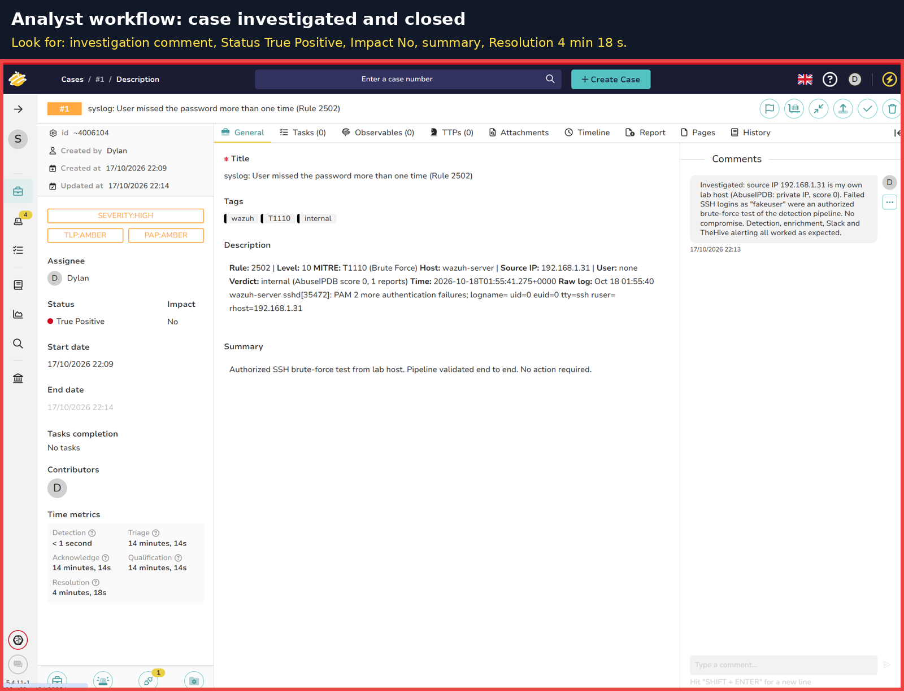

## Phase 10: Automatic Response

I needed an automatic response to stop the attacker within seconds without waiting for a human. Wazuh does the blocking, not n8n.

The first step was to back up the config file, using PowerShell on my host PC SSH'd into the Wazuh VM (ssh wazuh-user@192.168.1.211, then sudo -i).

I then installed iptables, which is Linux's built-in firewall tool. It decides what network traffic is allowed and what gets dropped. Wazuh's blocking script works by adding iptables rules, and the Wazuh OVA's Amazon Linux didn't have iptables installed.

I then added the Active Response block:

```
<active-response>
  <command>firewall-drop</command>
  <location>local</location>
  <rules_id>5712,5763</rules_id>
  <timeout>180</timeout>
</active-response>
```

| Line | Meaning | Plain English |
|---|---|---|
| &lt;command&gt;firewall-drop&lt;/command&gt; | Which script to run | "Block this IP with the firewall" |
| &lt;location&gt;local&lt;/location&gt; | Run it on the machine where the attack happened | Here that's the Wazuh server itself, since its SSH was the target |
| &lt;rules_id&gt;5712,5763&lt;/rules_id&gt; | Only these rules trigger it | Only SSH brute-force alerts, not every alert |
| &lt;timeout&gt;180&lt;/timeout&gt; | Remove the block after 180 seconds | A 3-minute timeout |

The two rules:

- 5712: 8 or more "invalid user" attempts (rule 5710) from the same IP within 120 seconds → brute force.
- 5763: the same idea, for repeated wrong passwords on real usernames.

I then added my PC to the whitelist, which is a list of IPs that are never blocked no matter what, because I don't want to lock myself out of my own server. I added &lt;white_list&gt;192.168.1.31&lt;/white_list&gt; in the global section of ossec.conf.

I then restarted Wazuh.

I had also included rule 2502, and the Active Response log showed "Cannot read 'srcip' from data." Rule 2502 comes from my system's login log, and those alerts don't include an attacker's IP. firewall-drop needs an IP to block, so when it doesn't have one, it can't block anything.

I then removed rule 2502 and kept 5712 and 5763, which always include the source IP. I learned to only automate a response on alerts that have the data the response needs.

I then tested the block using an attack from TheHive VM's console. I ran a loop of 12 SSH attempts at Wazuh as a fake user:

```
for i in $(seq 1 12); do ssh -o BatchMode=yes -o ConnectTimeout=3 -o StrictHostKeyChecking=no fakeuser@192.168.1.211; done
```

1. Attempts 1–7: each one fired rule 5710 (invalid user).
2. Attempt 8: fired rule 5712 (brute force), and Wazuh ran firewall-drop.
3. Attempt 9: "Connection closed," because the block landed mid-connection. Attempts 10–12: timed out, because the firewall was now dropping all traffic from 192.168.1.184.
- Proof, on the Wazuh VM:
  - iptables -L showed a DROP rule for 192.168.1.184.
  - /var/ossec/logs/active-responses.log showed the block being added.
- After 180 seconds: the log showed the block removed, and iptables -L was clean again. Auto-unblock confirmed.
- At the same time: the alert still went through n8n to Slack and TheHive. Detect, block and notify all happened together.

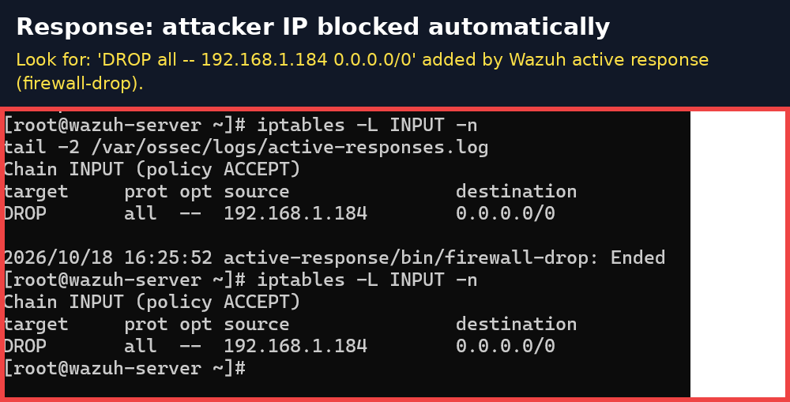

## Phase 11: Health Monitoring

The next phase was health monitoring. If one of these tools (n8n, TheHive, Wazuh) stops silently, nobody would know.

The plan:

| Part | Who watches whom | How |
|---|---|---|
| A | n8n watches TheHive and Wazuh | A Health Check workflow every 5 minutes |
| B | Wazuh watches n8n | A watchdog script on the Wazuh VM every 5 minutes |
| C | n8n watches itself | An Error Handler workflow when the pipeline breaks |

Any failure posts a 🔴 alert to Slack.

I made another workflow called Health Check in n8n in my browser.

Step 1 was a Schedule Trigger. I used a node that starts the workflow every 5 minutes on its own, because health checks need to run without humans checking.

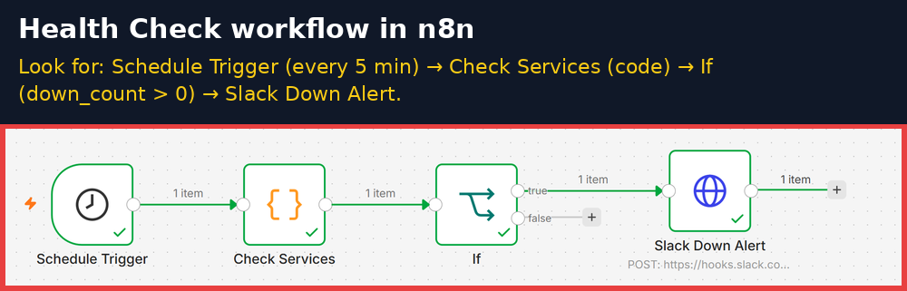

Step 2 was a Code node called Check Services, which is a small JavaScript program that checks 3 services with web requests and a 5-second timeout.

| Service | Address it checks | Counts as "up" when | Why that rule |
|---|---|---|---|
| TheHive | 192.168.1.184:9000/api/status | It replies 200 (OK) | TheHive has a status page made for this |
| Wazuh API | 192.168.1.211:55000 | It replies 401 or 200 | 401 = "unauthorized," meaning it's alive and asking for a login. I didn't send one on purpose, because the check only needs to know it's answering. |
| Wazuh Dashboard | 192.168.1.211:443 | Any reply under 500 | 500 and above means a server error. Anything else means the dashboard is running. |

- What it outputs: all_up (true/false), down_count (how many are down), down_services (which ones), and the check time.
- Why code instead of 3 separate nodes: one node checks everything and builds a single summary. That's cleaner and gives one alert instead of three.

Step 3 was the If node. It checks whether down_count is greater than 0: true means something is down, and false means nothing is down.

The next step was the Slack Down Alert node, which posts SERVICE DOWN with a red light, which services are down, when they were checked, and what to do.

I then published this as "v1 – health checks every 5 min."

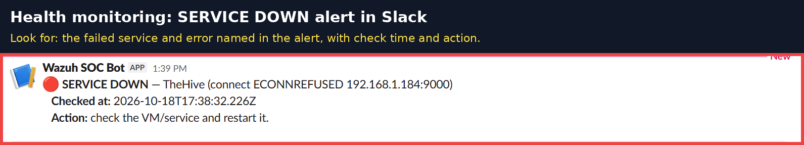

The next part was Wazuh watching n8n. If n8n dies, the Health Check dies with it, and alerts stop reaching Slack and TheHive with nothing reporting it. Something outside of n8n has to check on n8n, so I used the Wazuh VM, since it's always running.

I stored the Slack webhook secretly and wrote the watchdog script, which asks n8n "are you OK?" at 192.168.1.31:5678/healthz and waits up to 5 seconds. If n8n answers OK and it was down last time, the script posts RECOVERED to Slack; if not, it does nothing. If n8n doesn't answer, it posts SERVICE DOWN. If it has already reported it, it stays quiet.

- How it remembers: a small state file (/var/tmp/n8n-watchdog.down). The file existing means "I already reported n8n is down."
- Why the state file: without it, I'd get a DOWN message every 5 minutes for as long as n8n is down. This way I get one DOWN and one RECOVERED, with no spam.

I then made it run every 5 minutes, start automatically on boot, and log every run.

Step 3: Made it run every 5 minutes with systemd

- Two files in /etc/systemd/system/:
  - n8n-watchdog.service: what to run (the script, once).
  - n8n-watchdog.timer: when to run it, 2 minutes after boot, then every 5 minutes.
- What systemd is: Linux's built-in manager for services and scheduled jobs.

Step 4: Proven on a real failure

- What happened: n8n actually wasn't running at one point, because the PowerShell window had been closed. I noticed there were no Slack alerts.
- When I restarted n8n: the watchdog sent a real 🟢 RECOVERED message.
- This also exposed a weakness: alerts sent while n8n was down were lost, because Wazuh doesn't retry. That goes in my limitations.

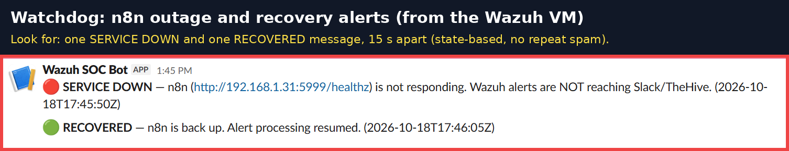

n8n can be running while the SOC Pipeline crashes on a bad alert, like the no-IP Windows alert. Without this, the alert disappears and nobody knows. Because of this, I made a new workflow called Error Handler.

I made an Error Trigger node, which is a special trigger that fires when a linked workflow fails. I then made a Slack Error Alert node that posts WORKFLOW FAILED to Slack, so I know which workflow failed, which node it failed on, the error message, and a link to the execution so I can click right to the failure. I then linked it to the SOC Pipeline, which tells n8n that if that workflow fails, it should run this one. I tested this, and it caught two bugs: WORKFLOW FAILED at AbuseIPDB (the Windows alert with no IP), and WORKFLOW FAILED at Edit Fields1 (abuse_score expected a number but got "n/a").

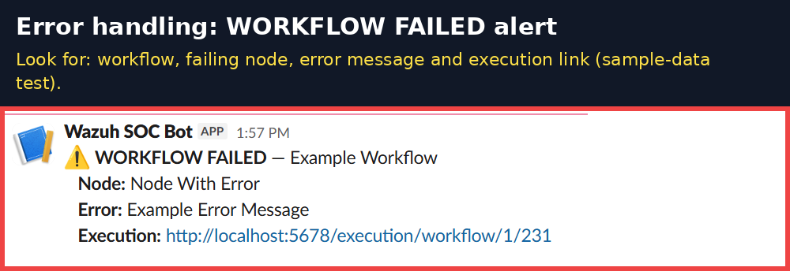

## Phase 12: Final Testing

My last phase was final testing. I did a Windows/Sysmon end-to-end test. Every test before was an SSH brute force on Linux, so I needed to prove the pipeline can also catch attacks on a Windows workstation, which attackers also target. I ran suspicious commands on the Windows VM.

I used certutil, a Windows tool, to download a file from the internet. I used certutil because it's a real Windows program that attackers abuse to pull malware onto a machine, since it's already installed and looks legitimate.

I then watched the flow through the whole pipeline: Sysmon recorded that certutil.exe ran a command and downloaded a file; the Wazuh agent shipped the event to Wazuh on port 1514; Wazuh matched rule 92207, tagged MITRE T1105, at a level high enough for Critical; and n8n parsed it, triaged it as Critical, and skipped the IP lookup because there was no IP address. In under a second, Slack showed a Critical alert and TheHive had a ticket.

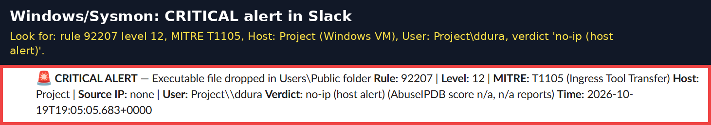

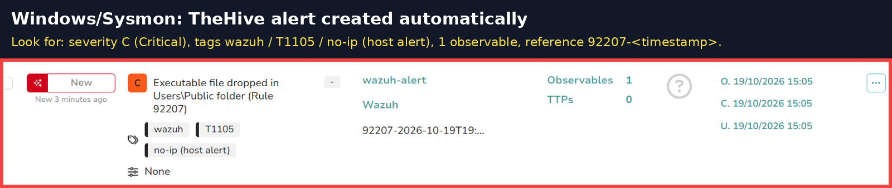

### The 5 fixes it took to get there

This test failed several times first, and each failure taught something:

| Problem | Cause | Fix |
|---|---|---|
| Agent showed Disconnected | Pointed at .210 instead of .211, and the VM was on NAT (192.168.85.133), so it couldn't reach Wazuh | Fixed the IP, switched to Bridged (192.168.1.141) |
| No alerts reached n8n | n8n wasn't running, and alerts sent while it was down were lost | Restarted n8n. The watchdog sent a real RECOVERED. |
| WORKFLOW FAILED at AbuseIPDB | Host alerts have no IP | On Error → Continue, plus the no-ip verdict |
| WORKFLOW FAILED at Edit Fields1 | abuse_score was Number but got "n/a" | Changed the field to String |
| Windows user missing | Windows stores the user in a different place (data.win.eventdata.user) | Added it to the user field's fallback list in Normalize |

I then tested the whitelist to see whether my PC can be blocked, even if it triggers a brute-force alert. I ran failed SSH logins from my host PC to the Wazuh VM, enough to trigger rule 5712, and then checked the result on the Wazuh VM.

The result was that rule 5712 fired: Wazuh correctly detected it as a brute force, and the alert still went to Slack and TheHive. No block was applied to my IP address, which shows I can't lock myself out of my own server.

| # | Test | Expected | Result |
|---|---|---|---|
| 1 | SSH brute force with a fake user | Rule 5712 (T1110) fires | ✅ |
| 2 | Alert delivered to n8n | HTTP 200 in integrations.log | ✅ after the config fix |
| 3 | Low-severity alert (5710, level 5) | Stops at triage | ✅ 10 of 13 filtered |
| 4 | High alert → Slack + TheHive | Both created | ✅ under 1 s |
| 5 | Private IP enrichment | Verdict internal | ✅ |
| 6 | Duplicate alert replayed | Rejected by TheHive | ✅ |
| 7 | Tags on the TheHive alert | wazuh / T1110 / verdict | ❌ → ✅ fixed with the array format |
| 8 | Alert → case → closed | Documented verdict | ✅ |
| 9 | Auto-block after brute force | iptables DROP | ✅ after removing 2502 |
| 10 | Attacker actually cut off | Connections time out | ✅ |
| 11 | Auto-unblock | DROP removed after 180 s | ✅ |
| 12 | TheHive outage (docker stop thehive) | SERVICE DOWN in Slack | ✅ |
| 13 | n8n outage | One DOWN, one RECOVERED | ✅ simulated, then a real outage |
| 14 | Pipeline failure | WORKFLOW FAILED alert | ✅ caught 2 real failures |
| 15 | My PC never blocked | Whitelisted IP not dropped | ✅ |
| 16 | Windows/Sysmon end to end | Critical → Slack + TheHive | ✅ under 1 s, after 5 fixes |

## Limitations

- n8n runs inside a terminal window on my PC, so alerts are lost if it's closed.
- IPs come from DHCP and can change.
- Everything is on one flat network.
- Plain HTTP on ports 5678 and 9000.

## Improvements

- I plan to expand on this lab with a network-heavy pfSense firewall lab that mimics enterprise environments, separating the SOC tools and the employee workstation into their own network segments.

## Repository contents

| Folder | What's inside |
|---|---|
| `docs/` | Architecture and network topology diagrams |
| `evidence/screenshots/` | Key screenshots used in this write-up |
| `evidence/logs/` | Raw log excerpts: integration fix, Active Response tuning, block/unblock, health checks |
| `configs/wazuh/` | The integration and Active Response blocks from `ossec.conf` |
| `configs/thehive/` | `docker-compose.yml` and `.env.example` (no real secrets) |
| `scripts/` | `custom-n8n.py` integration, `n8n-watchdog.sh`, systemd service and timer |
| `n8n/` | Check Services code and notes on the workflows |

All secrets (API keys, the Slack webhook URL, passwords) are kept out of this repository.

## Keywords

### Core terms

- **SOC (Security Operations Center)** – a team, and the place they work, responsible for monitoring, detecting and responding to cyberattacks.
- **n8n** – a node-based workflow automation platform that connects different apps, APIs and databases. It can be self-hosted, which gives me control over my data and over what leaves my environment.
- **Wazuh** – a cybersecurity platform that combines SIEM (Security Information and Event Management) and XDR (Extended Detection and Response) in one tool. It lets me monitor and analyze many systems from one place.
- **TheHive** – a SIRP (Security Incident Response Platform): a case management tool designed for SOCs to manage the entire lifecycle of a cybersecurity incident.
- **SOAR (Security Orchestration, Automation and Response)** – a set of cybersecurity tools and platforms that help a SOC team collect data, streamline alert triage, and run automated response workflows.
- **Sysmon (System Monitor)** – a free Microsoft tool that logs detailed system activity to the Windows Event Log.
- **Slack** – a cloud-based communication and collaboration platform designed for teams and businesses.
- **SSH brute-force attack** – an automated cyberattack where an attacker uses scripts or bots to repeatedly guess username and password combinations to gain unauthorized access to a remote server running SSH (Secure Shell).

### Applications and tools I used

- **VMware Workstation** – software that creates and runs virtual machines on my PC.
- **Virtual machine (VM)** – a complete computer that runs as software inside another computer.
- **Physical host / host PC** – my real computer, which runs VMware and n8n.
- **Windows Event Log** – the built-in Windows record of system activity, where Sysmon writes its events.
- **SwiftOnSecurity Sysmon configuration** – a free, expert-written XML rule set that tells Sysmon what to record and what to ignore.
- **Wazuh agent** – a small program installed on a monitored computer that sends its logs to the Wazuh server.
- **Wazuh Active Response** – the Wazuh feature that automatically takes action, such as blocking an IP, when certain rules fire.
- **Wazuh API / Wazuh Dashboard** – the Wazuh server's programming interface (port 55000) and its web interface (port 443).
- **integratord** – the Wazuh service that runs integrations, such as my script that sends alerts to n8n.
- **AbuseIPDB** – a free public database where organizations report IP addresses that attacked them; it gives each IP an abuse score.
- **Node.js** – the software engine that n8n runs on.
- **PowerShell** – the Windows command-line program I used to run commands and connect to my servers over SSH.
- **Ubuntu Server** – a free, lightweight Linux operating system with no desktop, used for TheHive's VM.
- **Amazon Linux** – the Linux operating system that comes pre-installed in the Wazuh OVA.
- **OpenSSH Server** – the program that lets a computer accept SSH connections.
- **Docker** – a tool that runs programs inside containers.
- **Docker Compose** – a Docker tool that starts several containers together from one file (docker-compose.yml).
- **Docker Hub** – an online library of ready-made container images that Docker downloads from.
- **Cassandra** – the database that permanently stores TheHive's alerts and cases.
- **Elasticsearch** – the search engine that makes searching and filtering in TheHive fast.
- **iptables** – Linux's built-in firewall tool, used by Wazuh to block attacker IPs.
- **systemd** – Linux's built-in manager for services and scheduled jobs; I used it to run the watchdog every 5 minutes.
- **certutil** – a built-in Windows tool that attackers often abuse to download malicious files; I used it for my Windows test.

### n8n workflows, nodes and settings

- **Workflow** – a chain of connected nodes in n8n that runs automatically.
- **Node** – one step in an n8n workflow; each node does one job.
- **SOC Pipeline** – my main n8n workflow that receives, sorts, enriches and sends out Wazuh alerts.
- **Health Check** – my n8n workflow that checks every 5 minutes that TheHive and Wazuh are running.
- **Error Handler** – my n8n workflow that posts to Slack when the SOC Pipeline fails.
- **Webhook node** – the first node in the SOC Pipeline; it waits for Wazuh to send alerts to its web address.
- **Edit Fields node** – a node that picks out and renames fields; mine pulls the important facts out of each alert (parsing).
- **Normalize** – the name of my parsing (Edit Fields) step that builds the clean set of alert fields.
- **Switch node** – a node that sends data down different paths based on a value; mine sorts alerts into Critical, High or Low.
- **HTTP Request node** – a node that sends a web request to another service; I used it for AbuseIPDB and Slack.
- **Edit Fields1** – my second Edit Fields node, which assigns the verdict from the AbuseIPDB results.
- **TheHive 5 node** – the n8n node that creates alerts in TheHive.
- **Schedule Trigger** – a node that starts a workflow on a timer (every 5 minutes in my Health Check).
- **Code node** – a node that runs a small JavaScript program; mine is called Check Services.
- **Check Services** – my Code node that tests whether TheHive, the Wazuh API and the Wazuh Dashboard respond.
- **If node** – a node that checks a condition and splits the workflow into true and false paths.
- **Slack Down Alert** – my node that posts SERVICE DOWN to Slack.
- **Error Trigger** – a node that starts the Error Handler whenever a linked workflow fails.
- **Slack Error Alert** – my node that posts WORKFLOW FAILED to Slack.
- **Credential** – a saved, encrypted login or API key in n8n.
- **Header Auth** – a way of sending an API key inside the web request's header.
- **Allowed Domains** – an n8n credential setting that only lets the key be sent to the listed website.
- **On Error → Continue** – an n8n node setting that keeps the workflow running even if that node fails.
- **Listen for test event** – an n8n button that makes a webhook wait for one test message.
- **Execute step** – an n8n button that runs a single node for testing.
- **Publish** – making an n8n workflow live so it runs on its own, not just during tests.

### Pipeline and security concepts

- **SIEM (Security Information and Event Management)** – a system that collects logs from many machines in one place and checks them for attacks.
- **XDR (Extended Detection and Response)** – security that detects and responds to threats across many systems, such as computers, servers and networks.
- **Pipeline** – the chain of steps an alert passes through automatically, from detection to ticket.
- **Alert** – a notice that something suspicious happened.
- **Case** – an alert that has been promoted to a full investigation in TheHive.
- **Ticket** – a tracked record of an incident that analysts can assign, update and close.
- **Parsing / normalization** – pulling the important fields out of a raw alert into a clean, consistent format.
- **Triage** – sorting alerts by how serious they are, so the dangerous ones are handled first.
- **Enrichment** – adding outside information to an alert, such as an IP's abuse history.
- **Verdict** – the label given to an alert based on its enrichment: malicious, suspicious, clean, internal or no-ip (host alert).
- **Severity / rule level** – how serious an alert is; Wazuh uses levels 0–15 and TheHive uses 1–4.
- **Rule / rule ID** – a pre-written Wazuh pattern that describes an attack, and the number that identifies it (for example, 5712).
- **Rule 5710 / 5712 / 5763 / 2502 / 92207** – the Wazuh rules in my lab: an invalid SSH user, an SSH brute force, an SSH brute force with wrong passwords, a login-log failure with no IP, and a suspicious certutil download.
- **MITRE ATT&CK** – a public catalog of attacker techniques, each with an ID.
- **T1110 (Brute Force) / T1105 (Ingress Tool Transfer)** – the MITRE techniques in my tests: guessing passwords, and downloading attacker tools onto a machine.
- **Observable** – a piece of evidence that TheHive tracks, such as an IP address.
- **Tags** – labels on a TheHive alert that let analysts filter and search.
- **Organization (SOC-Lab)** – a team space in TheHive where alerts and cases live; the admin organization is only for managing the platform.
- **Service account** – an account used by a program instead of a person (n8n@soc.lab).
- **Least privilege** – giving each account or tool only the access it needs.
- **Deduplication** – preventing the same alert from being created twice.
- **sourceRef** – the unique ID TheHive uses to recognize duplicate alerts.
- **Whitelist** – a list of IP addresses that are never blocked.
- **firewall-drop** – the Wazuh script that blocks an IP address with iptables.
- **Timeout** – how long something waits before giving up, or how long a block lasts (180 seconds).
- **Health monitoring** – checking that the security tools themselves are still running.
- **Watchdog** – my script on the Wazuh VM that checks whether n8n is running.
- **State file** – a small file the watchdog uses to remember that it already reported n8n as down.
- **Host alert** – an alert about something that happened on a machine itself, with no attacker IP.
- **Living off the land** – attackers using tools already built into a system, like certutil, so their activity looks normal.
- **MTTA (time to acknowledge)** – the time from when an alert is created until an analyst starts working on it.
- **MTTR (time to resolve)** – the time from when work starts until the case is closed.
- **Authorized test** – an attack I ran on purpose against my own systems.
- **True positive / false positive** – a real detection versus an alert on harmless activity.

### Networking and data terms

- **IP address** – a computer's address on a network.
- **Private IP (192.168.x.x)** – an address used only inside a home or company network.
- **Public IP** – an address on the internet.
- **Port** – a numbered door on a computer that a specific program listens on (for example, 1514 for the Wazuh agent, 5678 for n8n, 9000 for TheHive, 22 for SSH).
- **localhost** – the computer you are currently on.
- **Bridged vs. NAT** – two VMware network modes: Bridged puts a VM on my home network like a real computer, and NAT hides it behind my PC.
- **Webhook** – a web address that waits for data to be sent to it.
- **API (Application Programming Interface)** – a way for programs to talk to each other directly.
- **API key** – a secret string that works like a password for programs.
- **GET / POST** – types of web requests: GET asks for information, and POST sends information.
- **HTTP 200 / 401 / 500** – web response codes: 200 means OK, 401 means a login is needed, and 500 or higher means a server error.
- **JSON** – an organized text format for sending data between programs.
- **Array** – a list of values, written in square brackets.
- **String** – a text value, as opposed to a number.
- **Errno 113** – a Linux network error meaning "no route to host": the address couldn't be reached.
- **Unexpected EOF** – an error meaning a file or message ended before it was supposed to, often because it is broken.
- **ECONNREFUSED** – an error meaning nothing is accepting connections at that address and port.
- **Healthz** – a common web address that a service uses to report whether it is healthy.

### Files, commands and system terms

- **Config file** – a file of settings that controls how a program behaves.
- **ossec.conf** – Wazuh's main configuration file.
- **Integration block** – the section of ossec.conf that tells Wazuh to send alerts to n8n.
- **hook_url** – the line in the integration block that holds n8n's webhook address.
- **integrations.log / active-responses.log** – Wazuh log files that record alert deliveries and automatic blocks.
- **docker-compose.yml** – the file that describes TheHive's three containers and how they connect.
- **.env file** – a file that holds secrets separately from the main configuration.
- **Container** – a sealed box that holds a program and everything it needs to run.
- **Image** – the downloadable template a container is created from.
- **Volume** – storage outside a container, so data survives restarts.
- **OVA** – a ready-made virtual machine packaged as one file.
- **ISO** – a file containing an operating system installer, like an install disc in file form.
- **LVM (Logical Volume Manager)** – a Linux disk system that lets partitions be resized later.
- **Root** – the all-powerful administrator account on Linux.
- **sudo** – a Linux command that runs another command as an administrator.
- **chmod / chown** – Linux commands that set who can read, edit or run a file, and who owns it.
- **usermod** – a Linux command that changes a user's settings, such as adding them to a group.
- **systemctl** – a Linux command that starts, stops and checks services.
- **apt / dnf** – the software installers on Ubuntu and on Amazon Linux.
- **ip a** – a Linux command that shows a machine's IP address.
- **ping** – a command that checks whether another computer can be reached.
- **ufw** – Ubuntu's simple firewall tool.
- **lvextend** – a Linux command that makes an LVM disk section bigger.
- **df -h** – a Linux command that shows how much disk space is used and free.
- **vm.max_map_count** – a Linux memory setting that Elasticsearch needs raised before it will start.
- **docker ps** – a Docker command that lists running containers.
